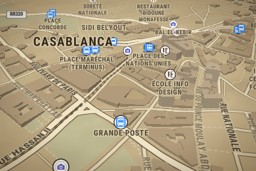

# My Map

Your own map styles for Morocco and the world, in 3D, with a live editor.

The data is OpenStreetMap. The look is yours: more than 290 ready-made skins
(game looks, Moroccan themes, one per Moroccan city, one per country of the
world coloured from its flag, a satellite globe), all with real terrain and
houses at their true height, plus a browser playground to edit any of them
live and tools to use them in your apps.



## Quick start

You need Python 3.10+ and a browser. No Docker, no API keys.

```powershell
git clone --recursive https://github.com/sabrine0/My-Map.git
cd My-Map
.\get-fonts.ps1            # downloads the font glyphs (about 140 MB, once)
python playground\serve.py
```

Then open <http://localhost:3030>. Pick a skin from the dropdown or the
Gallery, and read [playground/GUIDE.md](playground/GUIDE.md) to learn how
the styles work and how to make your own.

If you cloned without `--recursive`, run `git submodule update --init` to
fetch the export cleaner (optional, see Tools below).

## What is in the playground

- **Live editing**: open any file in `playground/skins/` in your editor,
  save, and the map redraws within a second. A red badge tells you what is
  wrong when a style does not parse.
- **Skins**: six game looks (sepia western, dark city, neon cyberpunk,
  blocks, green terminal, black-and-white), fifteen Moroccan themes
  (zellige, sahara, medina, chefchaouen, atlas, amazigh, ramadan night,
  essaouira, tafraout, mint tea, argan, ifrane, dakhla, caftan, relief),
  fifteen Moroccan city skins that fly to their city, 250 country skins
  coloured from the flag that fly to the capital, three classic cartography
  looks (blueprint, pencil sketch, noir) and an Earth skin with satellite
  imagery on a globe.
- **3D everywhere**: real terrain from free elevation tiles, shaded relief,
  extruded buildings lit by a movable sun, a globe mode, orbit, a tilt
  toggle.
- **Rich map**: tunnels, bridges, footpaths, rails with sleepers, airports,
  schools, hospitals, cemeteries, sports grounds, parks, forests, farmland,
  deserts, glaciers, POI icons, highway shields, house numbers, capitals
  emphasised, labels in French, Arabic, English or the local name.
- **Tools**: place search, directions with turn-by-turn steps, measure,
  satellite overlay, live rain radar, bookmarks, a tour of the Moroccan
  cities, a Tweak panel to change colours live and export your own style,
  PNG export, a data inspector, keyboard shortcuts (`?` lists them).

## Using a skin in your app

The playground server serves every skin as a MapLibre style URL with open
CORS and absolute font URLs:

```
http://localhost:3030/skins/<name>.json
http://localhost:3030/skins/country/<iso2>.json
```

Web (MapLibre GL JS):

```js
new maplibregl.Map({ container: 'map', style: 'http://localhost:3030/skins/zellige.json' })
```

Flutter (`maplibre_gl`): `MapLibreMap(styleString: 'http://<your-pc-ip>:3030/skins/zellige.json')`.
A phone cannot reach `localhost` on your PC; use the PC's LAN address, the
server fills the font URLs from whatever host you used.

3D, globe and satellite need MapLibre on the client. For apps that only take
flat PNG tiles, see the Docker tile server below.

## Docker tile server (optional)

`docker-compose.yml` builds Morocco's OpenStreetMap data into
`data/morocco.mbtiles` with Planetiler and serves it with tileserver-gl,
which rasterises every skin to PNG tiles:

```powershell
.\setup.ps1                        # fonts + build (10 to 20 min) + start
# later: docker compose up -d tiles
```

```
http://localhost:8081/styles/<skin>/{z}/{x}/{y}.png
```

Needs Docker Desktop, about 3 GB of disk and 4 GB of RAM. Refresh the data
with `docker compose run --rm build` then `docker compose restart tiles`.
The flat copies of the skins live in `styles/` and are registered in
`config.json`.

## Layout

```
playground/
  index.html          the viewer (MapLibre GL JS, no build step)
  serve.py            static server: live reload, font stack merging, /clean
  skins/              one JSON style per skin; skins/country/ the 250 countries
  skins.json          the list the dropdown reads
  thumbs/             gallery thumbnails
  GUIDE.md            how styles work, exercises, every tool explained
  style.json          a 4-layer starter to build your own from
  tools/
    make_skins.py     generates every skin from palettes (edit, then run)
    country_palettes.py / countries_palette.json   flag colours and capitals
    thumbs.js         renders the thumbnails (headless Edge + puppeteer-core)
    watermarks-remover/   git submodule, strips metadata from exports
styles/               flat copies for the Docker tile server
config.json           tile server settings (all skins registered)
docker-compose.yml    build + serve
setup.ps1             fonts + Docker build + start
get-fonts.ps1         just the fonts
```

## Regenerating skins

Every generated skin comes from `playground/tools/make_skins.py`: palettes
at the top, one shared 58-layer skeleton, 3D defaults applied to all. Edit a
palette and run:

```powershell
python playground\tools\make_skins.py
```

It rewrites `playground/skins/`, `playground/skins.json` and the flat copies
in `styles/`. Hand-written skins are plain JSON; copy any generated one and
edit.

## Credits and data

- Map data © [OpenStreetMap](https://www.openstreetmap.org/copyright)
  contributors, served as vector tiles by [OpenFreeMap](https://openfreemap.org/)
  (OpenMapTiles schema). Free, no key, fair use; for production traffic use
  the Docker tile server with your own data.
- Terrain: Mapzen Terrarium tiles on [AWS Open Data](https://registry.opendata.aws/terrain-tiles/).
- Satellite imagery © Esri, Maxar, Earthstar Geographics (World Imagery).
- Rain radar: [RainViewer](https://www.rainviewer.com/). Directions:
  [OSRM](http://project-osrm.org/) demo server. Place search:
  [Nominatim](https://nominatim.org/). Flags: [flagcdn.com](https://flagcdn.com/).
  Country data: [mledoze/countries](https://github.com/mledoze/countries)
  and Natural Earth.
- Fonts: [openmaptiles/fonts](https://github.com/openmaptiles/fonts)
  (Noto Sans, Roboto, Metropolis, Open Sans, PT Sans; OFL / Apache).
- Rendering: [MapLibre GL JS](https://maplibre.org/). Export cleaning:
  [watermarks-remover](https://github.com/guillaumemeyer/watermarks-remover) (MIT).

The styles and code in this repository are MIT licensed.
